# Лабораторная работа №1. Формулирование требований к программной системе

| Поле | Значение |
|---|---|
| **Студент** | Дегтярева Ульяна Владимировна |
| **Группа** | РИС23-1 |
| **Вариант** | Вариант №6 - Система регистрации и оплаты некредитных курсов университета |
| **Постановка задачи** | [ссылка на «Возможные варианты.docx»](https://docs.google.com/document/d/1l9oZuIYZcej5SZnC7KZQ3wCePuF3-xnC/edit?usp=sharing&ouid=110915178635352012572&rtpof=true&sd=true) |
| **Репозиторий** | [ссылка на GitHub](https://github.com/UlianaDegtiareva/Software-system-architecture-design.git) |
| **Дата сдачи** | 21.11.2026 |

**Тема:** Анализ предметной области и формулирование требований к программной системе.

**Цель работы:** Научиться анализировать поставленную задачу, выделять заинтересованных лиц, формулировать функциональные и нефункциональные требования, представлять результаты в виде диаграммы вариантов использования.

---

## Краткое описание системы

Разрабатываемая система предназначена для регистрации студентов и пользователей колледжа на некредитные курсы университета и оплаты выбранных занятий. Она должна поддерживать оплату банковской картой и наличными, регистрацию нескольких слушателей на несколько занятий в рамках одной покупки, а также проверку предварительных требований к курсам. После успешной оплаты сведения о регистрации студента должны автоматически передаваться в центральный реестр университета; для этого система взаимодействует с внешним сервисом реестра. Пользователи также могут запрашивать счета и квитанции с отправкой по электронной почте, а администраторы управляют курсами и просматривают сведения о платежах без доступа к персональным данным студентов.

При проектировании учитываются небольшой ИТ-бюджет. Поэтому в первой версии приоритет отдается обязательным процессам регистрации, оплаты и передачи данных в центральный реестр, а автоматизация менее критичных операций может быть реализована позднее.

---

## Оглавление

- [Лабораторная работа №1. Формулирование требований к программной системе](#лабораторная-работа-1-формулирование-требований-к-программной-системе)
  - [Краткое описание системы](#краткое-описание-системы)
  - [Оглавление](#оглавление)
  - [1. Перечень заинтересованных лиц (стейкхолдеров)](#1-перечень-заинтересованных-лиц-стейкхолдеров)
  - [2. Перечень функциональных требований](#2-перечень-функциональных-требований)
  - [3. Диаграмма вариантов использования](#3-диаграмма-вариантов-использования)
    - [Диаграмма](#диаграмма)
    - [Описание ключевого сценария](#описание-ключевого-сценария)
  - [4. Перечень нефункциональных требований](#4-перечень-нефункциональных-требований)
  - [5. Перечень сделанных предположений](#5-перечень-сделанных-предположений)

---

## 1. Перечень заинтересованных лиц (стейкхолдеров)

Выделено 6 стейкхолдеров, включая двух внешних (платёжный шлюз и центральный реестр университета). Влияние оценено по степени принятия решений и частоте использования системы.

| ID | Стейкхолдер | Роль | Интересы / цели | Влияние |
|----|-------------|------|-----------------|---------|
| SH-01 | Студент / пользователь колледжа | Основной пользователь | Быстро записаться на один или несколько курсов для себя или нескольких слушателей, оплатить картой или наличными, получить квитанцию на email, видеть статусы регистраций и платежей | Высокое (основной пользователь системы и получатель её ценности) |
| SH-02 | Администратор курсов | Сотрудник университета | Управлять каталогом курсов, устанавливать количество мест, контролировать заполняемость, видеть списки курсов, количество регистраций и статусы платежей без доступа к персональным данным студентов | Высокое (отвечает за каталог курсов и организацию процесса регистрации) |
| SH-03 | Бухгалтерия | Финансовый отдел | Фиксировать оплату наличными, контролировать поступления и возвраты, просматривать финансовую информацию и формировать отчёты | Высокое (отвечает за учёт платежей и финансовую отчётность) |
| SH-04 | Центральный реестр университета | Внешняя система | Получать сведения об успешно оплаченных регистрациях и изменениях по ним, поддерживать актуальность данных | Среднее (критичная интеграция, но решения о работе реестра принимает его владелец) |
| SH-05 | Платёжный шлюз (эквайринг) | Внешний сервис | Безопасно обрабатывать платежи банковскими картами, возвращать статус транзакции и поддерживать операции возврата | Среднее (необходим для карточных платежей, но может быть заменён другим провайдером) |
| SH-06 | Почтовый сервис | Внешний сервис | Получать запросы на отправку счетов и квитанций, доставлять документы на электронную почту пользователей | Среднее (необходим для отправки документов, но может быть заменён другим сервисом) |

---

## 2. Перечень функциональных требований

Сформулировано 14 функциональных требований. Приоритезация выполнена по методу MoSCoW с учётом жёсткого срока (6 месяцев) и малого бюджета: в первую очередь реализованы функции, без которых система не решает основную проблему (регистрация + оплата + синхронизация с реестром).

| ID | Требование | Стейкхолдер | Приоритет (MoSCoW) | Обоснование |
|----|------------|-------------|---------------------|-------------|
| FR-01 | Система должна позволять пользователю добавить одного или нескольких студентов на один или несколько курсов в рамках одной покупки | SH-01 | Must | Требование заказчика|
| FR-02 | Система должна проверять предварительные требования к курсу перед добавлением в корзину и блокировать запись при их отсутствии | SH-01, SH-02 | Must | Явное требование; снижает количество ошибочных регистраций |
| FR-03 | Система должна принимать оплату банковской картой через интегрированный платёжный шлюз | SH-01, SH-05 | Must | Основной способ онлайн-оплаты |
| FR-04 | Система должна поддерживать оплату наличными с последующей ручной фиксацией платежа бухгалтерией | SH-01, SH-03 | Must | Требование заказчика |
| FR-05 | Система должна автоматически создавать и подтверждать локальные записи о регистрации после получения подтверждения успешной оплаты банковской картой или фиксации оплаты наличными сотрудником бухгалтерии | SH-02 | Must | Ядро отслеживания регистраций |
| FR-06 | Система должна автоматически передавать данные о успешной регистрации в центральный реестр университета | SH-04 | Must | Требование заказчика |
| FR-07 | Система должна позволять администратору и бухгалтерии просматривать списки курсов, количество регистраций и статусы платежей без отображения персональных данных студентов (ФИО, контакты) | SH-02, SH-03 | Must | Требование по защите персональных данных |
| FR-08 | Система должна позволять студенту запросить квитанцию/счёт и отправить её на указанный email | SH-01, SH-06 | Should | Повышает удобство и снижает нагрузку на бухгалтерию |
| FR-09 | Система должна позволять администратору вручную инициировать обновление или удаление соответствующей записи в центральном реестре университета | SH-02, SH-04 | Should | Постановка допускает ручное выполнение обновлений и удалений, хотя автоматизация предпочтительна |
| FR-10 | Система должна уведомлять администратора о сбоях синхронизации с центральным реестром и поддерживать повторную отправку данных | SH-02, SH-04 | Should | Позволяет своевременно обнаруживать ошибки интеграции и восстанавливать передачу данных |
| FR-11 | Система должна позволять администратору управлять каталогом курсов: добавлять, редактировать и закрывать набор на курс | SH-02 | Should | Необходимо для эксплуатации системы и управления предложением курсов |
| FR-12 | Система должна обеспечивать аутентификацию пользователей и разграничение прав доступа в соответствии с их ролями (студент, администратор курсов, сотрудник бухгалтерии) | SH-01, SH-02, SH-03 | Must | Необходимо для идентификации пользователей и ограничения доступа к персональным и финансовым данным |
| FR-13 | Система должна позволять студенту или администратору отменять регистрацию на курс с изменением статуса локальной записи и передачей соответствующих изменений в центральный реестр | SH-01, SH-02, SH-04 | Should | Необходимо для поддержания актуальности сведений о регистрациях и обработки отмен |
| FR-14 | Система должна поддерживать оформление возврата денежных средств при отмене оплаченной регистрации в соответствии с правилами университета | SH-03, SH-05 | Should | Необходимо для обработки возвратов за отменённые регистрации; способ возврата зависит от исходного способа оплаты и правил университета |

---

## 3. Диаграмма вариантов использования

Диаграмма построена в Mermaid. Все Use Case соответствуют функциональным требованиям (ID FR указан в названии). Показаны связи include для общих сценариев (оплата, проверка prerequisites) и extend для опциональных действий.
М
**Связь с требованиями:** ID соответствующего FR указан в названии Use Case (например, `UC-03 [FR-03]`).

### Диаграмма

```mermaid

flowchart TB

    Student["Студент / пользователь колледжа"]
    Admin["Администратор курсов"]
    Accountant["Сотрудник бухгалтерии"]
    PaymentGW["Платёжный шлюз"]
    Registry["Центральный реестр университета"]
    Email["Почтовый сервис"]

    subgraph System["Система регистрации и оплаты дополнительных курсов"]
        UC01(["UC-01 [FR-01] Добавить слушателей и курсы в одну покупку"])
        UC02(["UC-02 [FR-02] Проверить предварительные требования"])
        UC03(["UC-03 [FR-03] Оплатить покупку банковской картой"])
        UC04(["UC-04 [FR-04] Зафиксировать оплату наличными"])
        UC05(["UC-05 [FR-05] Создать локальные записи о регистрации"])
        UC06(["UC-06 [FR-06] Передать сведения о регистрации и её изменениях в центральный реестр"])
        UC07(["UC-07 [FR-07] Просмотреть списки курсов, количество регистраций и статусы платежей"])
        UC08(["UC-08 [FR-08] Запросить счёт или квитанцию"])
        UC09(["UC-09 [FR-09] Вручную обновить или удалить запись в реестре"])
        UC10(["UC-10 [FR-10] Уведомить администратора о сбое и повторить отправку"])
        UC11(["UC-11 [FR-11] Управлять каталогом курсов"])
        UC12(["UC-12 [FR-12] Войти в систему"])
        UC13(["UC-13 [FR-13] Отменить регистрацию"])
        UC14(["UC-14 [FR-14] Оформить возврат денежных средств"])
    end

    Student --- UC12
    Student --- UC01
    Student --- UC03
    Student --- UC08
    Student --- UC13

    Admin --- UC05
    Admin --- UC12
    Admin --- UC07
    Admin --- UC09
    Admin --- UC10
    Admin --- UC11
    Admin --- UC13

    Accountant --- UC12
    Accountant --- UC04
    Accountant --- UC07
    Accountant --- UC14

    PaymentGW --- UC03
    PaymentGW --- UC14
    Registry --- UC06
    Registry --- UC09
    Email --- UC08

    UC01 -.->|include| UC02

    UC05 -.->|extend: оплата картой успешна| UC03
    UC05 -.->|extend: наличная оплата зафиксирована| UC04

    UC05 -.->|include| UC06
    UC13 -.->|include| UC06

    UC10 -.->|extend: ошибка передачи данных| UC06

    UC14 -.->|extend: если предусмотрен возврат| UC13

```

### Описание ключевого сценария

| Поле | Значение |
|---|---|
| **Use Case** | UC-01 + UC-02 + UC-03 + UC-05 + UC-06 [FR-01, FR-02, FR-03, FR-05, FR-06] Регистрация нескольких слушателей на курсы и оплата покупки |
| **Актор** | Студент / пользователь колледжа (SH-01) |
| **Предусловие** | Пользователь авторизован в системе; курсы опубликованы и открыты для регистрации |
| **Основной поток** | 1. Пользователь добавляет одного или нескольких слушателей и выбирает для них один или несколько курсов.  2. Система проверяет предварительные требования для каждого выбранного курса (UC-02).  3. Пользователь подтверждает состав покупки.  4. Система перенаправляет пользователя на оплату банковской картой (UC-03).  5. Платёжный шлюз подтверждает успешную оплату.  6. Система создаёт локальные записи о регистрации для выбранных слушателей (UC-05).  7. Система автоматически передаёт сведения об оплаченных регистрациях в центральный реестр (UC-06).  8. Пользователь получает подтверждение регистрации и может запросить счёт или квитанцию (UC-08). |
| **Постусловие** | Платёж учтён, локальные записи о регистрации созданы. При успешной синхронизации сведения внесены в центральный реестр. Если синхронизация завершилась ошибкой, данные сохраняются для повторной отправки, а администратор получает уведомление |
| **Альтернативный поток** | A1. Предварительные требования не выполнены для одного или нескольких слушателей → система не позволяет добавить соответствующего слушателя на выбранный курс и показывает причину.  A2. Оплата картой отклонена → регистрация не подтверждается; пользователь может повторить оплату или выбрать наличный способ оплаты.  A3. Пользователь выбирает оплату наличными → система создаёт заказ со статусом «ожидает оплаты». После получения наличных сотрудник бухгалтерии фиксирует платёж (UC-04), система подтверждает оплату, создаёт локальные записи о регистрации и передаёт сведения в центральный реестр.  A4. Сбой синхронизации с реестром → локальные записи сохраняются, администратор получает уведомление (UC-10), повторная отправка данных выполняется позднее.  A5. Пользователь или администратор отменяет регистрацию → система изменяет статус локальной записи и передаёт соответствующие изменения в центральный реестр (UC-13). Если по правилам университета положен возврат, оформляется возврат денежных средств (UC-14). |

---

## 4. Перечень нефункциональных требований

Выбраны 5 наиболее критичных нефункциональных требований с учётом небольшого ИТ-бюджета, жёсткого срока подготовки системы и чувствительности обрабатываемых данных (платежи и персональные данные). Отдельные требования высокой доступности (например, 99,99 %) и сложной аналитики не включены, поскольку могут быть нереалистичны при имеющихся ресурсах.

| ID | Категория | Требование | Метрика / критерий приёмки | Почему выбрано |
|----|-----------|------------|----------------------------|----------------|
| NFR-01 | Performance | Система должна обеспечивать приемлемое время отклика основных операций (выбор курсов, формирование заказа, просмотр информации о регистрации) | ≤ 2 с для 95-го перцентиля при нагрузке до 100 одновременных пользователей; ожидание ответа платёжного шлюза не учитывается | Система должна оставаться отзывчивой в период активной регистрации; критерий учитывает предполагаемую нагрузку небольшого университета |
| NFR-02 | Security | Система должна обеспечивать защиту персональных и платёжных данных | Использование TLS 1.2 или выше; отсутствие хранения полных данных банковских карт; маскирование персональных данных в интерфейсе администратора; отсутствие уязвимостей уровня High/Critical по результатам проверки OWASP Top 10 | Работа с платежами и персональными данными требует защиты информации; отдельно учитывается ограничение доступа администратора |
| NFR-03 | Reliability | Система должна обеспечивать надёжную передачу данных в центральный реестр | Не менее 99 % успешных передач за месяц; при сбое должны выполняться повторные попытки, а администратор должен получать уведомление в течение 5 минут | Автоматическая передача данных является одним из ключевых требований; сбои не должны приводить к потере сведений о регистрациях |
| NFR-04 | Usability | Система должна обеспечивать простоту основных пользовательских сценариев | Оформление покупки и переход к оплате должны выполняться не более чем за 7 действий пользователя, не считая ввода данных и ожидания ответа внешних сервисов | Понятный интерфейс снижает вероятность ошибок и нагрузку на поддержку |
| NFR-05 | Cost | Система должна иметь низкую стоимость развёртывания и сопровождения | Развёртывание и базовое администрирование должны быть доступны силами 1–2 сотрудников без выделенной DevOps-команды; по возможности используются открытые или бесплатные компоненты | Небольшой ИТ-бюджет является одним из основных ограничений проекта |

---

## 5. Перечень сделанных предположений

Постановка задачи содержит недостаточно подробностей для однозначного определения всех правил работы системы. Ниже перечислены предположения, принятые для уточнения требований и проектирования решения.

| ID | Предположение | Влияние на требования |
|----|---------------|-----------------------|
| A-01 | Система работает в Российской Федерации, основной язык интерфейса — русский | Влияет на локализацию, требования к обработке персональных данных, включая применимость 152-ФЗ, и выбор платёжных сервисов |
| A-02 | Центральный реестр университета предоставляет API (REST или иной интерфейс) для приёма регистраций и обновления сведений; формат обмена можно согласовать | Позволяет реализовать автоматическую передачу данных по FR-06 и передачу изменений по FR-13; при отсутствии API потребуется альтернативный механизм обмена |
| A-03 | Студенты могут использовать существующую университетскую учётную запись или зарегистрироваться по электронной почте; сотрудникам предоставляются учётные записи с соответствующими ролями | Определяет способ реализации аутентификации и разграничения прав доступа по FR-12 |
| A-04 | Оплата наличными фиксируется бухгалтерией после фактического получения денежных средств; до подтверждения оплаты заказ имеет статус «ожидает оплаты» | Определяет порядок подтверждения платежа и создания регистрации по FR-04 и FR-05 |
| A-05 | Пиковая нагрузка не превышает 100 одновременных пользователей | Позволяет установить измеримый критерий производительности по NFR-01 и выбрать решение, соответствующее масштабу университета |
| A-06 | Счета и квитанции формируются в формате PDF и отправляются через SMTP-сервер университета или внешний почтовый сервис | Определяет способ реализации FR-08 и требования к защите отправляемых документов |
| A-07 | Условия отмены регистрации и возврата денежных средств определяются правилами университета. Возврат при оплате картой обрабатывается через платёжный шлюз, а при оплате наличными — бухгалтерией | Определяет порядок реализации FR-13 и FR-14 |
